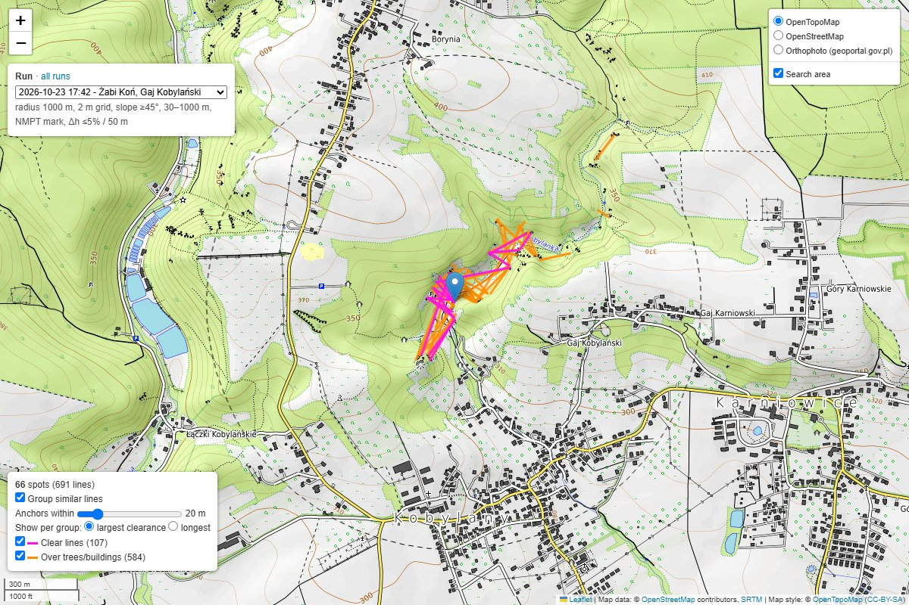
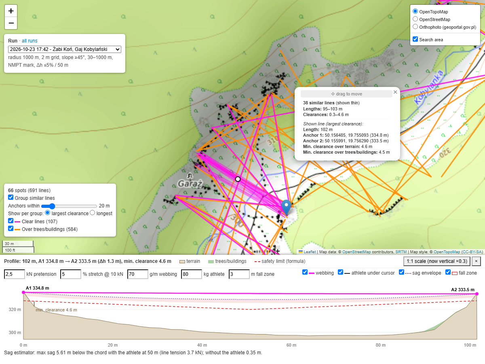
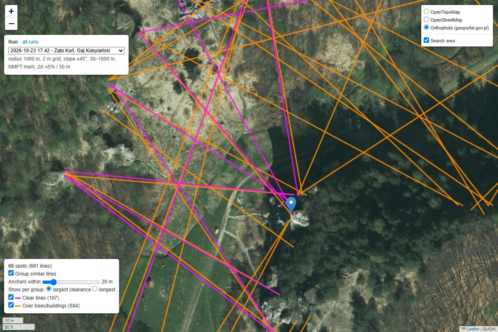

# Find a Line
This is an application that finds topographically valid highlines. It downloads elevation data for the area you choose and evaluates the potential of each raster pixel by applying a custom "maximum elevation formula" (or a physical sag estimate of the webbing).

Where a country publishes airborne LiDAR data, the tool uses it: a terrain model (ground only) and a surface model including trees and buildings. Built in, and picked automatically from the location of the search:

| Country | Data | Grid |
| --- | --- | --- |
| Poland | GUGiK NMT / NMPT ([geoportal.gov.pl](https://www.geoportal.gov.pl)) | 1 m (NMPT 0.5–1 m) |
| Malta | Planning Authority LiDAR 2018 (2012 on request) | 1 m |
| Spain, incl. the Balearic and Canary Islands | IGN MDT05 / MDS05 (PNOA-LiDAR) | 5 m |
| Switzerland, Liechtenstein | swisstopo swissALTI3D / swissSURFACE3D Raster | 0.5 m (terrain also 2 m) |
| Slovakia | ÚGKK SR DMR 5.0 / DMP 1.0 (our own tiles, see *Data*: needs a local copy for now) | 1 m |

Other countries can be added (see *Data sources*). Everywhere else in Europe (and the world) the tool uses 30 m global models (FABDEM and Copernicus DEM), which is enough for long lines only. NASADEM and your own raster files are supported too. The sea and lakes are filled in where the data has none, so lines between sea cliffs are found as well.

**Limitations and future scope**
- High-resolution data is built in for Poland, Malta, Spain, Switzerland and Slovakia only; elsewhere the 30 m models find long lines only, and at 5 m (Spain) lines shorter than about 30 m are not reliable.
- Trees and buildings are taken into account through NMPT (on by default, `--nmpt off` to skip it). Other factors that make rigging difficult are not.
- It would be nice to overlay with property maps.
- The math behind line dynamics is very nuanced and somewhat complex. By default we use a simple formula; the sag estimator (`--model sag`) models the webbing physically, but still with anchors at ground level.
- Because our formula always takes into account the elevation of the lowest anchor, the lines may be off-level, or required to be rigged shorter than shown on the map.
- Please be aware that our formula **does not** take into account the additional height required for a safe mainline failure.

## Maximum Elevation Formula
Due to deflection, the further an athlete travels from the nearest anchor the lower elevation required. The maximum safe elevation for a hypothetical 0 metre highline is 6 metres lower than the anchors- this is to account for a leash fall. From there we require 15cm more clearance for every metre longer the line is. This slope was calculated based on 155kg athlete walking a median stretch webbing tensioned at 2kN.

The formula for safe elevation at any given point on a highline can be described as


- a<sub>1</sub> = anchor 1
- a<sub>2</sub> = anchor 2
- c = current point
- d = distance from the current point to an anchor (metres)
- e = elevation (metres)

This can also be visualised as a slope below the line that is always exactly 6 metres below the line at maximum deflection.


## Sag Estimator
Instead of the formula above, lines can be checked against a physical estimate of the webbing (`--model sag`). Inspired by the [Highline Sag Calculator](https://sagcalc.krw.sk), the webbing is modelled as an elastic catenary:
- the webbing has its own weight (`--webbing-weight`, g/m) and stretches under load (`--stretch`, % at 10 kN);
- its unstretched length follows from the pretension (`--pretension`, kN) for the given span and height difference of the anchors;
- the athlete (`--athlete-mass`, kg) is a point load. For every position of the athlete along the line the webbing shape is solved, which gives the *sag envelope*: how low the webbing is under the athlete at each point;
- below the envelope a *fall zone* (`--fall-zone`, m) must stay free of terrain (and of trees/buildings with NMPT).

Anchors are taken at ground level, as with the formula. With the default values (2.5 kN, 5% @ 10 kN, 70 g/m, 80 kg, 3 m) the estimator is less strict than the formula for most lengths, so it finds many more lines; tune the values to your setup. The interactive map always shows the estimator in the line profile, whichever model was used for the search.

## Algorithm Breakdown
- Elevation data for a circle around the given point is downloaded in tiles from the data source (see *Data sources*) and resampled to the working resolution (`--resolution`). Tiles are cached, so a second run over the same area does not download anything.
- Slope is computed from the terrain model (or read from your own slope raster, `--slope-file`). Pixels steeper than `--slope-threshold` degrees become promising anchors.
- A line between two anchors is "drawn" with a DDA (Digital Differential Analyzer) algorithm, which gives every raster pixel between them. For each pixel the maximum acceptable elevation is calculated using our formula (or the sag estimator), and the pixel's actual elevation is subtracted from it to get the clearance. A **positive** clearance means the pixel is **lower** than the required maximum; if every pixel has a positive clearance, the line is valid.
- Checking every pair of anchors this way would be slow (a 1 km circle at 1 m has around 100 million pairs), but almost all of them fail within a few metres of an anchor: the terrain right next to it has to be about 6 m lower. So the search skips what cannot pass, without losing any valid line:
  - For every anchor and 64 directions, it checks how far a line could leave the anchor before the terrain is certainly too high for any partner. Anchors with no open direction are dropped (usually most of them).
  - Partners are anchors at the right distance, at most 5% of the line length or 50 m apart in height, and with both anchors open towards each other.
  - The pixels of the remaining lines are checked from both anchors inwards, stopping at the first one that is too high.
  - This runs as compiled code (numba) on all CPU cores; the lines found are checked once more pixel by pixel to compute their clearances.
- The same check is repeated against the surface model (treetops, roofs), unless `--nmpt off`. In `mark` mode lines that fail it are kept but drawn in orange; in `reject` mode they are dropped.
- The list of valid lines is then converted into GPS coordinates, printed, and displayed on a map.

## Data sources
| `--source` | Where | Terrain (DTM) | Surface (DSM, trees/buildings) | Orthophoto (cached) |
| --- | --- | --- | --- | --- |
| `geoportal` | Poland | GUGiK NMT sheets, 1 m, newest survey | GUGiK NMPT sheets, 0.5–1 m (about 85% of Poland) | geoportal.gov.pl |
| `malta` | Malta | MSDI DTM 2018, LiDAR 1 m (heights in whole metres) | MSDI DSM 2018, 1 m | MSDI 2018 |
| `malta2012` | Malta | MSDI DTM 2012, centimetre heights, gaps filled from 2018 | MSDI DSM 2012 | MSDI 2018 |
| `spain` | Spain (peninsula, Balearic Islands) | IGN MDT05, PNOA-LiDAR 5 m | IGN MDS05, 5 m | PNOA (IGN) |
| `spain_canarias` | Canary Islands | IGN MDT05 (REGCAN95 / UTM 28N), 5 m | IGN MDS05, 5 m | PNOA (IGN) |
| `swisstopo` | Switzerland, Liechtenstein | swissALTI3D, 2 m tiles for grids of 2 m or more, 0.5 m below; newest survey | swissSURFACE3D Raster, 0.5 m | SWISSIMAGE (swisstopo) |
| `slovakia` | Slovakia | ÚGKK SR DMR 5.0, ALS 1 m (2017–2023) | ÚGKK SR DMP 1.0, 1 m | ZBGIS (ÚGKK SR) |
| `europe` | anywhere | [FABDEM](https://data.bris.ac.uk/data/dataset/s5hqmjcdj8yo2ibzi9b4ew3sn) V1-2, 30 m (trees and buildings removed) | [Copernicus DEM GLO-30](https://registry.opendata.aws/copernicus-dem/), 30 m | – |
| `nasadem` | anywhere | NASADEM 30 m via the [OpenTopography API](https://portal.opentopography.org/apidocs/) | – | – |
| `files` | your files | `--elevation-file` | `--surface-file` (optional) | – |

- With the default `--source auto`, the country of the search centre is looked up in OpenStreetMap: Poland uses `geoportal`, Malta uses `malta` (2018), Spain uses `spain` (or `spain_canarias` on the Canary Islands), Switzerland and Liechtenstein use `swisstopo`, Slovakia uses `slovakia` when its tiles are set up (else `europe`, with the reason), anywhere else uses `europe`. Giving `--elevation-file` selects `files`.
- Downloaded data is kept in `cache/`, with one folder per country or Europe-wide dataset (`poland`, `malta`, `spain`, `switzerland`, `slovakia`, `copernicus30`, `fabdem`, `nasadem`, `osm`): switching between sources (or back) never downloads again what is already there, and deleting such a folder frees its space (it is downloaded again when needed). Inside, the path names the dataset, its edition and the tiling, e.g. `malta/dtm/2018/epsg32633-1m-2000px-tif/` or `copernicus30/2021/dem/`; `live` marks services that always serve their current state. Each folder has an `index.sqlite` listing its files with when and where they were fetched; every run records in `run.json` which data it used. Polish data is cached per map sheet (1:5000, about 2.3 × 2.3 km, one GeoTIFF of about 9 MB each), Swiss data per 1 km tile and survey as published (0.5 m: about 17–20 MB, 2 m: about 1.3 MB), Slovak data in our own 2 km tiles, Malta and Spain in WCS tiles of 2000 × 2000 pixels at native resolution (2 km and 10 km), the 30 m models in 1°×1° tiles; the same files serve every working resolution.
- **Keeping the cache up to date**: nothing is updated on its own. `python findaline.py cache status` lists the folders with their size, when their data was fetched and last used, what is due for a check, and the saved runs computed on data that has changed since. `python findaline.py cache update [FOLDER] [--all] [--bbox S,W,N,E | --point LAT,LON]` checks what is due: new surveys of the cached geoportal.gov.pl sheets and swisstopo tiles (the index is asked again after 180 days; a newer survey replaces the older file), tiles of services that serve their current state (IGN Spain, the orthophotos of geoportal.gov.pl, IGN and swisstopo; after 2 years), OpenStreetMap coastline and cliff tiles from Overpass (after a year), the world water polygons (after a year) and the OpenStreetMap extracts (after 30 days); tiles where a service had no data are checked again after 90 days. `--all` checks all of it however recent. Versioned releases (Copernicus 2021, FABDEM V1-2, NASADEM, Malta 2012/2018, Slovakia DMR 5.0 / DMP 1.0) never change and are never checked. A search can do the same for its own area first with `--update stale` or `--update all`.
- The default `--resolution` is the resolution of the terrain data, but not finer than 1 m: 1 m for the LiDAR sources (Poland, Malta, Switzerland, Slovakia), 5 m for Spain, 30 m for `europe` and `nasadem`, and the file's own resolution for `files`. Finer than 1 m cannot be chosen: it brings nothing for highlines (clearances are a matter of metres, and 0.5 m LiDAR grids are partly interpolated) and costs four times the pixels. A 1 m grid has four times the pixels of a 2 m one and finds many more lines (often ten times more in steep terrain), so `--resolution 2` is a good start for large areas. The grouping distance follows the resolution (twice the resolution, at least 20 m).
- Esri World Imagery is available as an online background layer everywhere; it is not cached, because Esri's terms do not allow downloading tiles for offline use.
- **NASADEM**: `--source nasadem` needs a free API key from [opentopography.org](https://portal.opentopography.org/myopentopo), given with `--opentopo-key` or in the `OPENTOPOGRAPHY_API_KEY` environment variable (step-by-step: [getting an API key](setup-for-regular-folk.md#getting-an-opentopography-api-key-optional)). Alternatively download a NASADEM GeoTIFF (or a slope raster) from the [OpenTopography portal](https://portal.opentopography.org/raster?opentopoID=OTSDEM.032021.4326.2), as in the original version of this tool, and use `--elevation-file` (and `--slope-file`).
- **Spain**: IGN publishes MDT05/MDS05 (5 m) through WCS; the finer MDT02 (2 m) is only available as files from the [CNIG download centre](https://centrodedescargas.cnig.es/CentroDescargas/modelo-digital-terreno-mdt02-segunda-cobertura), which has no download API, so it is not built in (you can download sheets yourself and use them with `--elevation-file`). At 5 m, lines shorter than about 30 m are not reliable. The data is requested as ASCII grids, which keep centimetres (the WCS GeoTIFF output is rounded to whole metres).
- **Licences**: FABDEM is free for non-commercial use only. Copernicus DEM, NASADEM, GUGiK, swisstopo ("© swisstopo"), ÚGKK SR (CC BY 4.0) and MSDI data are free to use with attribution.
- **Malta**: the 2018 survey covers the coast down to the sea, but its heights are published in whole metres. The 2012 survey has centimetre precision, but leaves out buildings and much of the coast (filled from 2018), and its WCS service places the data about 56 m east and 196 m north of the true position; `--source malta2012` corrects this (measured against Copernicus DEM and the 2018 survey at three places, the corrected data matches 2018 to 0.2 m).

### OpenStreetMap extracts
The coastline (`--coastline overpass`) and the cliffs and crags of `--area cliffs` come from the Overpass API, which is often overloaded. `python findaline.py osm download poland` downloads the whole OpenStreetMap data of a country or region from [Geofabrik](https://download.geofabrik.de) (Poland about 1.9 GB, Malta 9 MB; any Geofabrik id or name, e.g. `malta`, `spain`, `malopolskie`) into `cache/<country>/osm-extract/`. From then on the coastline and cliff tiles it covers are built from the extract, without Overpass; the part of a tile outside the extract may be open sea, but a tile reaching into another country is built from extracts only when that country's extract is there too. In the app, the *OSM* tab lists the regions at the map centre with a *download* button and the downloaded extracts with *update*. Without an extract, Overpass is asked, and a second server (maps.mail.ru) when the first is overloaded. `python findaline.py osm update` brings the extracts up to date with Geofabrik's daily diffs (a few MB), and rebuilds the tiles; `cache update` does it too once an extract is 30 days old.

### Sea, lakes and gaps in the data
LiDAR models usually have no data over water. Without it, lines across the sea between cliffs are never found, and neither are the cliff edges themselves (their slope needs the pixels next to them). By default (`--water fill`):
- **The sea** gets 0 m where the elevation data has none. Where the sea is comes from `--coastline`:
  - `overpass` (default): the OpenStreetMap coastline of the search area from the Overpass API (cached in `cache/osm/themes/coastline` in tiles of 0.25°), or from a downloaded OpenStreetMap extract (below). If Overpass does not answer, the Copernicus mask is used instead and a warning is printed. Once the world file below has been downloaded, it is used instead of Overpass (same OpenStreetMap data, no waiting for the server).
  - `world`: the OpenStreetMap water polygons of the whole world, downloaded once (about 900 MB) into `cache/osm/water-polygons/<date>/`; no Overpass needed afterwards.
  - `copernicus`: the Copernicus DEM water body mask (30 m).

  Measured along 2 km of the Maltese coast, 90% of the OpenStreetMap coastline is within 13 m of the shoreline in the LiDAR data (median 6 m), against 70 m for the Copernicus mask (median 12 m). Pixels without data within `--shore-buffer` metres (default 20) of the sea are taken as water too, as the mapped coastline is not exact; the exact shoreline comes from the elevation data itself. Cliffs can be vertical, so the land right next to the water may be high.
- **Lakes** of the Copernicus mask get the level of their shore.
- **Gaps on land** (for example under buildings in the Maltese 2012 data) are filled from another source (`--fill-gaps on`): Malta 2012 from Malta 2018, everything else from FABDEM 30 m. Each gap is shifted to match the heights around it. No anchors are taken at the edge of a filled gap, where two surveys meet.
- The popup of a line tells how much of it is over water and over filled gaps, the profile shows water in blue, and `lines.csv` has `water_m` and `filled_m` columns.

### Adding a country
Most European countries publish LiDAR terrain models as open data, many through an INSPIRE WCS service. To add one, add a `Source` to `SOURCES` in [sources.py](sources.py), modelled on the Malta entry:

```python
Source(
    id="austria", name="Austria (BEV)", description="BEV ALS DTM and DSM 1 m",
    nmt=WcsTiles("DTM Austria", "https://.../wcs", "coverage_id", "EPSG:31287", "austria/dtm",
                 native_res=1.0, fetch_res=1.0, axes=("E", "N")),
    nmpt=WcsTiles("DSM Austria", "https://.../wcs", "coverage_id", "EPSG:31287", "austria/dsm",
                  native_res=1.0, fetch_res=1.0, axes=("E", "N")),
    countries=("at",), crs="EPSG:31287",
    ortho=OrthoService("Orthophoto Austria", "https://.../wms", "layer", "austria/ortho", "BEV"))
```

- `crs` is the service's coordinate system (metric), `axes` the axis labels the service expects in `SUBSET` (see its DescribeCoverage), and `fetch_res` the resolution of the cached tiles (usually the native resolution; leaving it out lets the server downsample to the working resolution, which some services do badly: check the coverage at coarse resolutions).
- `countries` holds the ISO codes for which `--source auto` picks it. The default working resolution follows the terrain layer's `native_res` (at least 1 m); `default_resolution` overrides it.
- `OrthoService` is a WMS requested in WGS84. When it covers only part of the country and answers with white elsewhere, `base_url` (a `{z}/{x}/{y}` Web Mercator tile URL, up to `base_max_zoom`) fills those parts, as for geoportal.gov.pl.
- `OrthoService` without a WMS (`url=None`) uses the `base_url` tiles alone, as for SWISSIMAGE; `detail` limits the groups with detailed tiles where the service's terms ask for restraint.
- Services that publish files instead of WCS can use `DegreeTiles` with a function returning the URL of a tile, as for FABDEM and Copernicus, `SheetTiles` when a sheet index lists the files (geoportal.gov.pl), or `StacTiles` for a STAC collection with one item per tile and survey (swisstopo). A country that publishes only huge archives gets our own tiles: `GridTiles` on a fixed grid, made by a converter like [tools/sk_tiles.py](tools/sk_tiles.py) (Slovakia).
- How to research a country's data and choose between files, WCS and a hosted copy: [docs/data-sources.md](docs/data-sources.md).

## Getting Started
New to the terminal? Follow the [step-by-step setup guide](setup-for-regular-folk.md) for macOS and Windows.

Get the code and install the dependencies with [uv](https://docs.astral.sh/uv/) (it also installs Python 3.12 or newer if needed); `pyproject.toml` and `uv.lock` pin the tested versions:

```
git clone https://github.com/reastdignity/Find-a-Line.git
cd Find-a-Line
uv sync
```

Then run the script with the centre of the area you want to search:

```
uv run findaline.py --lat 49.2320 --lon 19.9817
```

Without uv, install the libraries listed under `dependencies` in `pyproject.toml` with pip into a Python 3.12+ environment and run `python findaline.py ...`. The examples below use `python findaline.py`; with uv write `uv run findaline.py`.

No data files are needed; everything is downloaded automatically into the `cache` folder. The `cache`, `runs` and `work` folders are kept in the folder of the script; `--data-dir` or the environment variable `FINDALINE_DATA` moves all three elsewhere (for example to another disk).

The search centre can be given in either of two coordinate systems:
- **WGS84** (`--lat`, `--lon`), as shown in Google Maps or a GPS. Example: `--lat 49.2320 --lon 19.9817`
- **PL-1992 / EPSG:2180** (`--northing`, `--easting`), in metres. Note that geoportal.gov.pl labels the northing as **X** and the easting as **Y**. Example: `--northing 152074 --easting 571448`

Instead of a circle, `--area` searches any area; both anchors of a line lie inside it, while the webbing may leave it (e.g. over a bay):
- `--area coast --buffer 100 --within osm:"Gozo"`: within 100 m of the OpenStreetMap coastline of Gozo and of everything within `--max-length` of it: islets off its coast, the sea side of the coastline and the cliff edges are included (the named area itself is only the land of the island); coastline a little further away is reported. A box (`--within S,W,N,E`) clips the band instead;
- `--area cliffs --buffer 50 --within 50.14,19.73,50.18,19.78`: within 50 m of OSM cliffs (`natural=cliff`) and crags (`climbing=crag`);
- `--area my-area.geojson` (or KML, GPX): polygons as they are, points and lines grown by `--buffer`;
- `--area osm:"Ojcowski Park Narodowy"`: a named OpenStreetMap area (Nominatim).

The script shows the size of the area, the number of tiles and the download before it starts, and asks to go on (`--yes` skips the question). Large areas are computed tile by tile (`--tile-size`, by default as large as a quarter of the free memory allows; each tile also reads `--max-length` around it, but looks for lines only from the anchors inside it); every finished tile is saved, so running the same command again after an interruption carries on where it stopped. In the map of an area only the line shown for each group has a terrain profile saved (any other line gets its profile computed in about half a second when the map is opened from the app, `findaline.py web`), and detailed aerial photos are kept for the best `--ortho-detail` groups (50; swisstopo 20, for circles too); `lines.csv` and `lines.geojson` hold every line.

### In the browser
`uv run findaline.py web` (or double-click `start.bat` on Windows, `start.command` on macOS, `./start.sh` on Linux) starts Find-a-Line as a page in your browser, served from your own computer only (`http://127.0.0.1:8765/`; `--port`, `--no-browser`, `--data-dir`). Click the map for the centre of a circle, draw polygons or rectangles, load a GeoJSON/KML/GPX file, or choose the OpenStreetMap coast, cliffs or a named area; set the options (the same as on the command line, without file paths), press *Estimate* to see the data source, the size and the download, then *Start*. The form tells how many separate areas the drawn or loaded shapes make (shapes that overlap or touch are one area; points and lines of a file count with their buffer); *Clear all* removes the point, the drawn shapes and the file, and starting a search does the same, so the next one starts from an empty map with the same options. Searches wait in the *Queue* with live progress and can be cancelled; a finished one has *run again* (the same search queued again; a large area resumes where it stopped) and *edit* (its place and options loaded into *New search* to change them); one search computes at a time, and the next one already downloads its data meanwhile. A finished search is an ordinary run: *open map* opens its map, and *Runs* lists all of them. Close the window of the server (or press Ctrl+C) to stop it; a search running at that moment is stopped, and a large area resumes where it stopped when it is started again.

Several places at once: give `--point LAT,LON` (WGS84) once per place, optionally with a name for the run, `--point LAT,LON,NAME`. They are searched one after another with the same options, and each is saved as its own run. Example: `--point 50.15595,19.75627,"Żabi Koń" --point 50.17332,19.74092`

### Options
| Option | Default | Description |
| --- | --- | --- |
| `--point` | | `LAT,LON[,NAME]`: search around this point; repeat for several places (one run each) |
| `--area` / `--buffer` / `--within` | – / 100 / – | Search an area instead of a circle: `coast`, `cliffs`, a GeoJSON/KML/GPX file or `osm:<name>`; `--buffer` around coastline, cliffs, points and lines; `--within` (needed for `coast` and `cliffs`): `osm:<name>` takes the coastline or cliffs within `--max-length` of that area, a box `S,W,N,E` clips the band |
| `--tile-size` | from the free memory | Side of the square tiles a large area is computed in, metres |
| `--ortho-detail` | 50 for an area, all for a circle; swisstopo: 20 | Detailed orthophoto only around this many best groups; the others load it online |
| `--source` | `auto` | Data source: `auto`, `geoportal`, `swisstopo`, `slovakia`, `malta`, `malta2012`, `spain`, `spain_canarias`, `europe`, `nasadem`, `files` (see *Data sources*) |
| `--elevation-file` / `--surface-file` | | Your own terrain / surface raster (GeoTIFF, ASC...) |
| `--water` | `fill` | Fill the sea and lakes where the data has none (`off` to skip) |
| `--coastline` | `overpass` | Where the sea is: `overpass`, `world` or `copernicus` (see *Sea, lakes and gaps*) |
| `--shore-buffer` | 20 | Metres around the sea where pixels without data are still taken as water |
| `--fill-gaps` | `on` | Fill gaps in the data on land from another source |
| `--opentopo-key` | `OPENTOPOGRAPHY_API_KEY` | OpenTopography API key for `--source nasadem` |
| `--radius` | 1000 | Search radius around the centre, in metres |
| `--resolution` | the data's own, at least 1 | Working resolution in metres, at least 1: by default 1 for LiDAR sources, 5 for Spain, 30 for `europe`/`nasadem` |
| `--min-length` / `--max-length` | 30 / 1000 | Line length constraints, in metres |
| `--slope-threshold` | 45 | Minimum terrain slope (degrees) for an anchor |
| `--max-anchor-diff` / `--max-anchor-diff-m` | 5 / 50 | Maximum height difference of the anchors: % of the line length / metres (whichever is smaller) |
| `--slope-file` | | Your own slope raster in degrees (GeoTIFF or ASC) instead of computing it from NMT |
| `--nmpt` | `mark` | `mark` or `reject` lines that pass too close to trees or buildings; `off` skips the check and the NMPT download |
| `--high-above` | 20 | Height of the webbing above the terrain, in metres, from which a part of a line counts as high (`high_pct`) |
| `--min-height` / `--min-mean-height` | | Keep only lines whose webbing gets at least this many metres above the terrain somewhere / on average (see *Height above the terrain*) |
| `--min-high-share` | | Keep only lines at least `--high-above` above the terrain over this % of their length |
| `--max-wall-angle` | | Keep only lines that leave both anchors at most this many degrees from the downslope direction (0: straight out over the drop, 90: along the wall) |
| `--min-prominence` / `--min-prominence-both` | | Keep only lines with one anchor / both anchors at least this many metres prominent (see *Prominence and drop*) |
| `--prominence-span` | 300 | Width in metres from which terrain no longer counts as the anchor's own rock |
| `--min-drop` / `--drop-radius` | / 50 | Keep only lines whose anchors are both at least this many metres above the lowest terrain within `--drop-radius` metres |
| `--threads` | CPU count - 1 | Number of threads for the line search |
| `--model` | `formula` | Clearance model for the search: `formula` or `sag` (see *Sag Estimator*) |
| `--pretension` / `--stretch` | 2.5 / 5 | Pretension in kN / webbing stretch at 10 kN in % |
| `--webbing-weight` / `--athlete-mass` | 70 / 80 | Webbing weight in g/m / athlete mass in kg |
| `--fall-zone` | 3 | Height below the sagged webbing that must stay free, in metres |
| `--data-dir` | `FINDALINE_DATA`, else the folder of the script | Folder holding `cache/` (downloaded data), `runs/` (saved runs) and `work/` (working grids of a search, deleted when it ends) |
| `--update` | | `stale` or `all`: check the cached data of the search area before the search (see *Keeping the cache up to date*) |
| `--group-distance` | 20 (2 × resolution if more) | Group similar lines: both anchors within this many metres |
| `--group-by` | `clearance` | Line shown for each group: `clearance` (largest), `longest` or `height` (highest above the terrain) |
| `--all-lines` | | List every line instead of one line per group |
| `--name` | place name from OpenStreetMap | Name of the run |
| `--html` | `findaline_map.html` in the data folder | Page that opens the map of the latest run |
| `--ortho` | `auto` | Orthophoto tiles for offline use of the map: `auto` asks when they would take more than 30 min (`--yes` downloads them), `always`, or `never` (the map loads them online) |
| `--no-html` / `--no-plot` | | Skip the interactive map / the matplotlib window |
| `-y`, `--yes` | | Do not ask for confirmation before long runs |

Run `python findaline.py --help` for the full list.

### Results
A steep rock face produces many near-identical lines (anchors shifted by a metre or two). Such lines are grouped into one spot: two lines belong to the same group when both of their anchors are within `--group-distance` metres of each other. Each group is shown as one line, the one with the largest clearance (or the longest one, `--group-by longest`, or the one highest above the terrain, `--group-by height`). Lines over trees/buildings are grouped separately from clear lines.

- The coordinates are printed in the terminal (WGS84, latitude and longitude), one line per group with the number of similar lines. Use `--all-lines` to list every line.
- Every run is saved in its own folder, `runs/<date>_<place>/`: the interactive map (`map.html` with its data in `data.js`; the viewer itself is shared by all runs in `runs/_viewer/`), all lines with their group number (`lines.csv` for spreadsheets, `lines.geojson` for QGIS and other GIS tools) and the parameters (`run.json`). Runs are named after the nearest rock, peak or valley in OpenStreetMap and the locality (for example "Żabi Koń, Gaj Kobylański"); use `--name` to choose your own. `runs/index.html` lists all runs.
- The interactive map can be opened in any web browser; `findaline_map.html` always opens the latest run. The panel in the top-left corner shows the run's parameters and switches to any other saved run. You can switch between OpenTopoMap, OpenStreetMap and the geoportal orthophoto, and click a line to see its length, anchor elevations and clearance. The panel in the bottom-left corner turns grouping on and off, sets the grouping distance and the line shown for each group. Clicking a line hides all the other lines (the variants of its group stay, drawn thin) until its popup is closed or *Show all lines* is pressed in the bottom-left panel; *Zoom to line* in the popup zooms the map to it. Clicking a group shows all of its lines. Clicking a line also opens its terrain profile at the bottom of the map: terrain (NMT), trees and buildings (NMPT) and the safety limit used by the search, with the point of smallest clearance marked. The sag estimator adds the webbing under its own weight, the sag envelope, the fall zone and, under the mouse cursor, the webbing with the athlete standing there; each can be switched on and off, and the rigging values can be changed in the panel to see the effect immediately. Moving the mouse over the profile shows the values at that point and marks it on the map; the button switches between a fitted and a true (1:1) vertical scale. A popup can be moved off the line by dragging its top bar.
- *Measure* (top left, only in a map opened from the app, `findaline.py web`): click two points and the profile between them opens in the same panel, computed from the run's data like the profile of a found line, so you can see why there is no line where you expected one (the sag, the anchors, or the terrain in the way). The anchors are on the ground; set how many metres above it each one is (a mast, a tree) in the panel. The title tells the smallest clearance and whether the line fits; the length may be outside the search's limits, up to 6000 pixels of the run's grid (6 km at 1 m). Esc or *Cancel* stops measuring.
- *Height above the terrain*: every line has the largest and the mean height of its webbing above the terrain and the share of its length that is at least `--high-above` (20 m) above it (`height_max_m`, `height_mean_m`, `high_pct` in `lines.csv`). The webbing is the one of the clearance model: with `--model sag` the chord between the anchors minus the sag under the athlete, so the heights follow the rigging values of the search; with the formula the minimum elevation formula without its leash fall (lower anchor − 0.15 × distance to the nearer anchor). The profile marks the highest point; the popup shows all three values. A line that stays high from anchor to anchor has a high mean and `high_pct`; a line that is high only over one gully has a large maximum only. In steep mountains, where a search finds millions of lines, `--min-height`, `--min-mean-height` and `--min-high-share` keep only the high ones already in the search: the others are dropped right after the clearance check, before they are grouped and saved, which saves memory and time (the same lines as the map's filters would leave, but the groups are formed of the kept lines only).
- *Angle to the wall*: at each anchor, the angle between the line and the direction in which the terrain falls there (the gradient of the 3 × 3 pixels around the anchor): 0° means the line leaves the edge straight out over the drop, 90° that it runs along the wall, which usually means it starts on a ledge or skims the face (`anchor1_wall_angle`, `anchor2_wall_angle` in `lines.csv`). The map filters by the larger of the two; `--max-wall-angle` does the same in the search, before the pixels of a pair are checked.
- *Prominence and drop* of the anchors tell how far they stand out. The prominence is the height of the anchor above the level at which the rock it stands on joins terrain wider than `--prominence-span` (300 m): imagine water rising from the valley, and the level at which the anchor's island becomes smaller than 300 m across. A free-standing tower gets its height above the saddle that joins it to the rest, the edge of a plateau or of a wall that goes on uphill about 0, a ridge narrower than the span the height of the ridge. A tower joined to a hillside by a high saddle is only a few metres prominent (Żabi Koń: mostly 0–6 m, at most 17 m); its exposure shows in the drop instead: the anchor's height above the lowest terrain within `--drop-radius` (50 m; 25–50 m at Żabi Koń). Both are in `lines.csv` (`anchor1_prominence_m`, `anchor1_drop_m`...) and in the popup. In the search, `--min-prominence` keeps the lines with one prominent anchor (a tower to the mainland), `--min-prominence-both` those between two (tower to tower), `--min-drop` those with a drop below both anchors; anchors that cannot reach them are left out before the pairs are searched, which is where these limits save the most. The grid of every search reaches `max(--prominence-span, --drop-radius)` beyond the area, so the values do not depend on where the area ends (and the data of that margin is downloaded too).
- *Filters* in the bottom-left panel narrow the lines down, each with a slider and a number field: length from and to, the smallest clearance over the terrain and over trees/buildings, the largest height difference of the anchors, the lowest anchor height, the largest and the mean height above the terrain, the share of the line at least `--high-above` above the terrain, the largest angle to the wall, the prominence of one or both anchors, the drop below both anchors, lines over water only or over land only, no lines over filled gaps, and the smallest number of similar lines in a group. Lines are filtered first and then grouped, so the line shown for a spot always passes the filters. The filters apply to the lines of other runs too, and the browser remembers them for every map.
- *Other runs* in the top-left panel adds the lines of other saved runs to the map, each run in its own colour (dashed over trees/buildings) with its search area: the runs within 20 km first, the others under *More runs*. Their lines are grouped together with the current run's, so a spot found by two runs is one spot; clicking such a line shows which run it comes from, with a link to that run's map (which has the terrain profile). The browser remembers which runs were chosen.
- In Switzerland the orthophoto is SWISSIMAGE (10 cm, tiles up to zoom 20, enlarged at 21); swisstopo's terms ask for no bulk downloads, so detailed tiles are cached for the 20 best groups only (`--ortho-detail`).
- In Poland the orthophoto is geoportal's high-resolution one (10 cm or finer) where it exists, and its standard one (25 cm, all of Poland) elsewhere: the high-resolution service covers mostly towns and answers with white outside them, so those parts of a tile come from the standard one.
- Orthophoto tiles for the map are saved in the source's folder (for example `cache/poland/ortho/live/wm256`), so the aerial photos also work without internet: the whole search area up to zoom 16, and a 30 m strip around each group's line up to the maximum zoom (21). Elsewhere the map loads the orthophoto online. The first run in an area can download a couple of thousand tiles (for example about 1700 tiles, 26 MB and 8 minutes for 66 spots within 1 km); later runs reuse them. Maps find the tiles through a relative path, so keep the `runs` and `cache` folders where they are; a map moved elsewhere loads everything online.
- A static map is shown in a separate window (close it to finish the program), with one line per group.

### Progress
The search runs in five steps (data, slopes, anchor pairs, coordinates/groups/profiles, saving), each with its stages: anchor pairs, checking lines, coordinates, over water and filled gaps, line profiles, grouping, saving results, saving the map. The app shows the step (and the tile of a large area) above the bar of the current stage.
While the script runs, two progress bars at the bottom of the terminal show downloads (elevation and orthophoto tiles) and computations (stitching tiles, finding anchors, evaluating anchor pairs, profiles, grouping), each with the current stage, speed and remaining time. When the output is written to a file instead of a terminal, a line of text with the progress is printed every 10 seconds. Set `FINDALINE_PROGRESS=bars` or `FINDALINE_PROGRESS=text` to force one of the two.

### Run time and data size
With the defaults (1 km radius at 1 m, NMPT on) the first run in Poland downloads about 100 MB and takes a minute or two (in Switzerland about 300 MB, which downloads in seconds), mostly downloading NMPT, which is much slower than NMT. The line search itself takes seconds. Larger areas grow quickly in data: a 20 km radius at 2 m is about 1.5 GB for NMT alone. Before downloading, the script prints an estimate and asks for confirmation if the download looks large. If it is too slow, compromise by doing at least one of the following:
- Use a smaller `--radius`
- Use a coarser `--resolution` (2 metres finds the longer lines with a quarter of the pixels; 5 or 10 metres is good for a first look at a large area)
- Raise `--slope-threshold`
- Change your minimum or maximum line lengths

## Examples
### Żabi Koń, Dolina Kobylańska
Żabi Koń is a limestone rock in Dolina Kobylańska near Kraków. Searching within 1 km of it with a 2 m grid (`--resolution 2`; the default is 1 m) and the other settings at their defaults (slope ≥45°, lines 30–1000 m, anchors at most 5% / 50 m apart in height, NMPT marking, maximum elevation formula):

```
python findaline.py --lat 50.1559508 --lon 19.7562722 --resolution 2
```

The terminal shows the settings, the progress of every step and finally the spots found (shortened):

```
Centre: 50.155951, 19.756272 (WGS84) / N 254576, E 554008 (PL-1992)
Radius: 1000m, resolution: 2m (1001 x 1001 px)
Length constraints: 30m - 1000m
Anchor height difference: at most 5% of the length and 50m
Slope threshold: 45 degrees
NMPT (trees/buildings): mark
Clearance model: maximum elevation formula
...
Found 8371 potential anchors to evaluate
Anchors with an open direction: 1000 of 8371
...
Found 691 valid lines in 66 spots (lines with both anchors within 20m are grouped, ...)
GPS Coordinates (lat, lon):
  Spot 1: 102m, min. clearance 4.6m
    38 similar lines, 95-103m
    Anchor 1: 50.156485, 19.755093
    Anchor 2: 50.155991, 19.756290
  Spot 2: 169m, min. clearance 3.8m
    22 similar lines, 168-174m
    Anchor 1: 50.155290, 19.756279
    Anchor 2: 50.154057, 19.754887
  ...
Run "Żabi Koń, Gaj Kobylański" saved to ...
```

On a 24-core PC the line search took a fraction of a second (plus a few seconds to compile the search code on the very first run); the first run in an area also downloads about 100 MB of elevation data and a few thousand orthophoto tiles.

Of the 66 spots, 16 have clearance over the trees as well (pink); the other 50 only over the terrain (orange). The interactive map (`findaline_map.html`) shows them all:



Clicking a line opens its details and the terrain profile. Spot 1 is a 102 m line from the slope north-west of the rock to the top of Żabi Koń, with 4.6 m to spare below the safety limit (dashed red). The sag estimator shows the webbing would sag about 5.6 m below the straight line between the anchors with an 80 kg athlete in the middle (2.5 kN pretension):



With the geoportal orthophoto you can check the rocks and trees at the anchors (zoomed in to a 10 m scale):



The same results are in `runs/2026-10-23_174205_Zabi-Kon-Gaj-Kobylanski/lines.csv`, one row per line, for example (selected columns):

| group | representative | group_size | length_m | clearance_m | clearance_nmpt_m | anchor1_lat | anchor1_lon | anchor2_lat | anchor2_lon |
| --- | --- | --- | --- | --- | --- | --- | --- | --- | --- |
| 1 | True | 38 | 101.5 | 4.56 | 4.55 | 50.156485 | 19.7550932 | 50.1559914 | 19.7562897 |
| 2 | True | 22 | 169.3 | 3.78 | 1.86 | 50.1552897 | 19.7562786 | 50.1540572 | 19.7548869 |

### More examples
```
# The same place, but checked with the sag estimator for your own setup
python findaline.py --lat 50.1559508 --lon 19.7562722 --model sag --pretension 3 --stretch 4 --athlete-mass 75 --fall-zone 4

# Centre given in PL-1992 coordinates (as shown on geoportal.gov.pl: X = northing, Y = easting)
python findaline.py --northing 254576 --easting 554008

# A first look at a larger area: coarser grid, only long lines, no NMPT
python findaline.py --lat 50.17332 --lon 19.74092 --radius 5000 --resolution 5 --min-length 100 --nmpt off

# Every pixel (1 m), steep rock only, short lines too, with your own name for the run
python findaline.py --lat 50.1528584 --lon 19.7846212 --resolution 1 --slope-threshold 60 --min-length 15 --name "Brama Bolechowicka"
```

### Earlier version
Before switching to geoportal.gov.pl data, this tool used 30 m NASADEM data. This is how the map looked for 2500-5000m lines in southern Washington:


And here is an example of one such location found using it.


## Data
- **Poland**: terrain NMT and trees/buildings NMPT as map sheet files, found through the sheet indexes (WFS `Skorowidze`) in height system PL-EVRF2007-NH and downloaded from opendata.geoportal.gov.pl (ASCII grid or zipped XYZ, PL-1992 or, in some cities, PL-2000). For every sheet the newest survey with a grid of 0.5–1 m is used. The NMT covers all of Poland; the NMPT about 85% of it, and the script warns when part of the search area has none (trees and buildings are not marked there). Some newer NMT sheets are labelled as made from aerial photos; in the sheets compared they held the values of the earlier laser scan. The WCS services are not used: they take 30–50 s per tile, their downsampling loses data at coarse resolutions, and the PL-KRON86-NH coverages stop at 2019. The data is averaged locally to the working resolution, so at coarse resolutions small objects such as single trees appear lower than they are. Source: Główny Urząd Geodezji i Kartografii, [geoportal.gov.pl](https://www.geoportal.gov.pl).
- **Malta**: DTM and DSM from the Planning Authority's LiDAR surveys (ERDF156), [Malta Spatial Data Infrastructure](https://msdi.data.gov.mt/geonetwork/srv/api/records/2269ab80-81a5-4f30-b8ce-2b16292b345d), WCS at `malta.coverage.wetransform.eu`, UTM 33N. Downloaded at 1 m and averaged locally.
- **Switzerland and Liechtenstein**: swissALTI3D (terrain) and swissSURFACE3D Raster (trees, buildings), © swisstopo (open government data, free use with attribution), found through swisstopo's STAC API (`data.geo.admin.ch/api/stac/v1`, its recommended download service) and downloaded as 1 km cloud-optimized GeoTIFFs, LV95 (EPSG:2056) with LN02 heights, each checked against its published sha256. Every tile exists per survey year; the newest is used, and older ones are deleted when a newer one is downloaded. Orthophoto SWISSIMAGE from the WMTS `wmts.geo.admin.ch` (Web Mercator).
- **Slovakia**: DMR 5.0 (terrain) and DMP 1.0 (trees, buildings) from the national airborne laser scanning 2017–2023, © ÚGKK SR (Úrad geodézie, kartografie a katastra Slovenskej republiky), CC BY 4.0, S-JTSK [JTSK03] (EPSG:8353) with Baltic heights (Bpv). ÚGKK publishes each model only as one ZIP of 155–200 GB, so [tools/sk_tiles.py](tools/sk_tiles.py) cuts them into 2 km cloud-optimized GeoTIFFs on the same 1 m grid (LERC, at most 5 mm error) with an `index.json` of sha256 sums. Until they are uploaded to Hugging Face the tiles are a local copy: set `FINDALINE_MIRROR` to the folder above `slovakia/` (e.g. `C:\Users\me\findaline-mirror`); a search copies the tiles it needs into `cache/slovakia/`. Without it, Slovakia uses `europe`. Orthophoto ZBGIS from `zbgisws.skgeodesy.sk` (WMS, CC BY 4.0).
- **Sea**: OpenStreetMap coastline (© OpenStreetMap contributors, ODbL) via Overpass, [Geofabrik](https://download.geofabrik.de) extracts or [osmdata.openstreetmap.de](https://osmdata.openstreetmap.de/data/water-polygons.html); Copernicus DEM water body mask.
- **Europe-wide**: FABDEM V1-2 (University of Bristol / Fathom; tiles from a public mirror on Hugging Face) and Copernicus DEM GLO-30 (ESA / Copernicus, AWS open data), reprojected to the UTM zone of the search centre.
- **Spain**: MDT05 and MDS05 from the PNOA-LiDAR project, © Instituto Geográfico Nacional (CC BY 4.0), WCS at `servicios.idee.es/wcs-inspire/mdt` and `wcs-mds.idee.es/mds`; orthophoto PNOA from `www.ign.es/wms-inspire/pnoa-ma`.
- **NASADEM**: NASA, via the OpenTopography global DEM API.

## Learn More
- [I'm a non-technical user, how do I run this?](setup-for-regular-folk.md)
- [ISA calculators](https://www.slackline.app)
- [BC Tension calculator](https://www.balancecommunity.com/pages/tension-calculator)
- [Geoportal elevation data (NMT/NMPT)](https://www.geoportal.gov.pl/pl/dane/numeryczny-model-terenu-nmt/)
