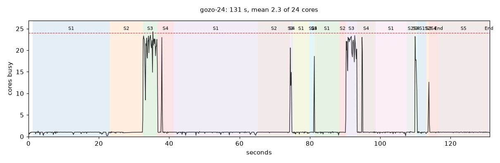
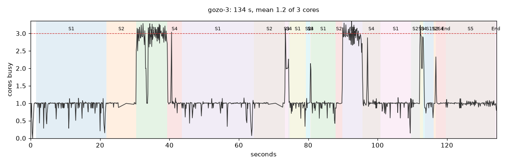
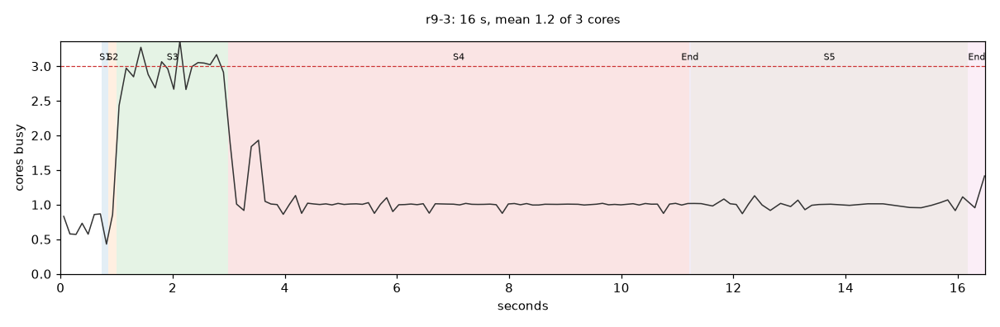

# Performance of the public site under many jobs

Measured 2026-10-31 on the development PC (12 cores / 24 threads, Windows 11, NTFS, the cache on a
local SSD). The public worker runs in a container with `WORKER_CPUS` (default 3) and
`WORKER_MEMORY` (default 8g). The VPS of findaline.lukawski.org has 8 cores and 24 GB, so its
worker gets 7 cores (`WORKER_CPUS`: the cores minus one) and about 20 GB. "3 cores" and "7 cores"
below are this PC restricted to that many physical cores (CPU affinity and `--threads N`), which is
what `search.line_threads` gives the worker in its container.

The question: one worker runs one job downloading and one computing at a time
(`jobs.Scheduler`, `running` keyed by phase), the quick lane beside them, and claims jobs first in,
first out. What limits it when many people queue jobs?

## How to measure again

| Script | What it does |
| --- | --- |
| `tools/perf_profile.py --out <dir> --name <n> [--cores N] -- <findaline options> --data-dir <scratch>` | Runs a search in its own process, follows the progress bars and samples CPU time and memory every 0.1 s: a table per stage (wall s, CPU s, cores busy, peak memory) and a timeline chart |
| `tools/perf_download.py --out <dir> --osm-from cache/osm --threads 2 4 8 -- <findaline options>` | The download phase (`search.download_data`) on an empty cache (only the OSM themes and Nominatim answers copied), with `sources.DOWNLOAD_THREADS` set |
| `tools/perf_sqlite.py --out <dir> --jobs 1 4 8 16 --pages 30 [--burst]` | `jobs.sqlite` with the real `jobs.Jobs` under K phase processes, the worker, the quick lane and M open pages |
| `tools/perf_profile.py ... --tracemalloc` | The same, with the peak of Python's heap per stage (numpy arrays included, memory-mapped grids not; several times slower) |
| `tools/perf_lines_memory.py --tiles <run>/tiles --out <dir> [--repo <checkout> --legacy]` | The lines of a tiled run through steps 4 and 5 by the code of a checkout: bytes per line as found, at the peak of step 4, held, at the peak of step 5 (`search.LINE_BYTES`) |

The searches ran on cached data (a scratch data folder whose `cache` is a junction to the real one)
with `--ortho never`, one at a time. Their results equal the regression table: R13 566 lines / 143
spots, R9 85 671 / 3 972, Gozo 403 026 / 2 734 (the run of 2026-10-28).

## 1. Cores used by one job

| Job | Size | 24 threads | 7 cores (VPS) | 3 cores | peak memory |
| --- | --- | ---: | ---: | ---: | ---: |
| small: R13 Kasprowy Wierch | 5 m, r 500 m, 566 lines | 1.9 s, 3.5 cores | | 1.7 s, 1.1 cores | 0.2 GB |
| medium: R9 Montserrat | 5 m, r 1 km, 85 671 lines | 15.7 s, 2.3 cores | 15.7 s, 1.5 cores | 16.8 s, 1.2 cores | 1.0 GB |
| large: Gozo coast ±100 m, 1 m | 9.65 km², 6 tiles, 403 026 lines | 129-131 s, 2.3 cores | 125 s, 1.4 cores | 134-135 s, 1.2 cores | 5.6 GB |

(Wall time and the mean number of cores busy.)

(R4, the 1 m Dolina Będkowska, takes 3 s and behaves like R13.) Times are of the search alone; the
worker adds a spawned process per phase (about 1 s of imports each).

**The line search is not the problem.** It is the only parallel code (numba `prange` in
`linesearch.py`) and uses the cores well (21-22 of 24, 3 of 3), but it is 6 % of the Gozo job on 24
threads and 12 % on 3 cores; on R9 it takes 0.6 s of 16. Everything else runs on one core, so 24
threads make the large job only 5 % faster than 3 cores. A job keeps 1.2 of 3 cores busy, 1.4 of
the VPS's 7: **on the VPS about 80 % of the worker's cores are idle while one job computes.**

Where the large job spends its time (24 threads, all 6 tiles together; cProfile for the parts
between the bars):

| Stage | Wall s | Cores | Where |
| --- | ---: | ---: | --- |
| gap filling (`sources.fill_gaps`) | 44 | 1 | 19 s in `scipy.ndimage.median` over the whole tile, 7 s own numpy, 11 s the FABDEM/Copernicus mosaic |
| anchor prominence and drop (`terrain.py`) | 20 | 1 | union-find in plain `@njit` (12 s) and an `argsort` of every pixel (5 s) |
| mosaics (`build_mosaic`: terrain, surface, water mask) | 9 | 1 | half of it `rasterio.warp.reproject` with GDAL's one thread |
| saving results and the map (`runs.save_results`, `mapping.save_map`) | 14 | 1 | CSV, GeoJSON, `json` of 403 026 lines |
| grouping, coordinates, tile files | 9 | 1-1.5 | |
| filling sea and lakes, sea mask | 8 | 1 | |
| line search (free directions, pairs, checking) | 7 | 18-22 | numba `parallel=True` |

R9 (a circle) has a different profile: line profiles 7.1 s (one `line_profile` per line, all 85 671
lines of a circle), saving 5 s, line search 0.6 s.

**A cheap fix found on the way.** `fill_gaps` calls `ndimage.median(values, ring, index=...)` on the
whole tile; scipy sorts every pixel, label 0 included. Passing only the ring pixels
(`ndimage.median(diff[ring > 0], ring[ring > 0], index=...)`) gives identical medians: on a
7 600 × 7 600 tile with 2 958 gaps, 10.5 s → 0.15 s. That is about 15 % of the Gozo job, with
the same lines (the regression checksums would not move).

## 2. Downloads

The download phase (`search.download_data`) does only network and file work: the layers one after
another (terrain, then surface, then the water mask), each with a pool of `DOWNLOAD_THREADS = 4`.
It keeps 0.1-0.3 cores busy (1.8 at 8 threads on Malta's WCS).

| Area, service | 2 threads | 4 threads (today) | 8 threads |
| --- | ---: | ---: | ---: |
| Gozo coast, Malta WCS (50 tiles, 196 MB received) | 66 s | 25 s | 15 s |
| Jura r 2 km, geoportal.gov.pl sheets (18 sheets, 662 MB) | 285 s | 181 s | 121 s |
| two Jura areas at once, 4 threads each (17 + 18 sheets, 1 250 MB) | | 286 s and 315 s | |

- Each connection is slow: about 1 MB/s per geoportal sheet (earlier measurements gave 17 MB/s,
  docs/roadmap.md: the service varies), and Malta's WCS spends most of a request generating the
  tile. More threads help both, almost linearly up to 8.
- Two jobs downloading from geoportal at the same time got no more in total (1 250 MB in 315 s,
  4.0 MB/s) than one job with 8 threads (5.5 MB/s): the service (or the path to it) is the limit,
  not the number of jobs.
- The terrain and surface layers are downloaded one after the other, so a job waits for the slowest
  sheet of each layer twice.
- With one download slot, a slow download blocks everyone: the next job's download starts only when
  this one ends, even if it needs a different service or nothing at all (cached data).

Is it safe to run two download phases at once? Yes: each download writes its own `.part` file and
renames it (`cache.py`), `index.sqlite` is in WAL mode, and Nominatim and Overpass are already
limited across processes (`osm._ask`, `osm._overpass_turn`). What is missing is a lock per tile:
two jobs over the same area download the same tiles twice (correct, but wasted), and no limit per
host across jobs.

## 3. SQLite

| Database | Written by | Settings |
| --- | --- | --- |
| `jobs.sqlite` | worker (events, claims, heartbeat, quick lane), web (jobs, favourites, reports, usage) | WAL, `timeout=60`, a new connection per operation |
| `accounts.sqlite` | web (sign-ins, sessions: `seen`) | WAL |
| `audit.sqlite` | web and worker, one row per change | WAL |
| `cache/<top>/index.sqlite` | downloads, one row per tile | WAL |
| `cache/osm/nominatim.sqlite` | Nominatim answers | rollback journal (no WAL) |
| `cache/osm/nominatim-rate.sqlite` | pyrate-limiter's bucket | its own |

`jobs.sqlite` under load (`tools/perf_sqlite.py`, 30 s each; a phase writes a progress event every
0.3 s and an info event every 2 s, the worker its heartbeat every 5 s and its claims every 0.5 s,
the quick lane `quick_claim` every 0.05 s, each page reads its events and `worker_alive` every
0.5 s):

| Jobs at once | Pages | Events/s | event write, median / p99 | page read, median / p99 | errors |
| ---: | ---: | ---: | --- | --- | ---: |
| 1 | 30 | 4 | 2.3 / 18 ms | 14 / 22 ms | 0 |
| 4 | 30 | 17 | 6.6 / 60 ms | 6.8 / 23 ms | 0 |
| 16 | 30 | 66 | 5.1 / 117 ms | 4.4 / 24 ms | 0 |
| 4 | 100 | 17 | 12 / 85 ms | 17 / 175 ms | 0 |
| 4 | 400 | 17 | 11 / 86 ms | 122 / 307 ms | 0 |
| 4, no pauses | 30 | 429 | 5.0 / 114 ms | 17 / 30 ms | 0 |

- **SQLite is enough** for one machine, as decided (docs/roadmap.md: Postgres only with a second
  machine). The writes of 16 jobs at once are 66 events/s, a sixth of what four writers without
  pauses reach on this PC (429/s); no `database is locked` anywhere.
- **The limit is the web process, not the database:** every open page polls on its own (two
  queries every 0.5 s, each on a new connection with `PRAGMA journal_mode`). At 400 pages the
  reads queue behind the GIL of one process (median 122 ms) while the writes stay at 11 ms. The
  web container has one CPU (`WEB_CPUS=1`).
- The idle quick lane opens a write transaction (`BEGIN IMMEDIATE`) 20 times a second, the
  busiest writer when nothing happens; harmless now, but it competes with every other write.

## 4. Memory of a job

A search needs memory for its grids (step 1-3: the terrain, surface, water and gap grids of a
tile and their temporaries, `search.PIXEL_BYTES` per pixel) and for its lines (steps 4 and 5).
Until 2026-10-31 a line was a `helpers.Line` of Python floats and then a dict of its coordinates,
and step 5 built every row of `lines.csv` and `data.js` at once; the worker on the VPS was killed
at 3.7 million lines. Lines are now numpy columns (`helpers.LineTable`) from the line search to
the files, which are written chunk by chunk from them (the files are the same byte for byte:
R4, R9, R13 and the Gozo coast in tiles compared with the old code).

Bytes per line, the 403 026 lines of the Gozo coast through steps 4 and 5
(`tools/perf_lines_memory.py`, the grids apart):

| | a dict per line (before) | columns (now) |
| --- | ---: | ---: |
| the line search's output | 760 | 144 |
| peak of step 4 (coordinates, groups) | 2 213 | 421 |
| held between tiles | 1 605 | 236 |
| peak of step 5 (saving) | **3 050** | 382 |

Step 5 was the highest peak, above the 2.5 KB that `search.LINE_BYTES` counted; it is now
500 B. The whole search (no tracemalloc, tiles of 5 km, the same lines):

| Gozo coast, 403 026 lines | before | now |
| --- | ---: | ---: |
| peak memory of step 4 | 1.71 GB | 0.78 GB |
| peak memory of step 5 | 1.67 GB | 0.48 GB |
| peak memory of the job (step 1, the grids of a 50 Mpx tile) | 3.87 GB | 3.48 GB |
| wall time | 125 s | 112 s |

- **The grids now decide the peak** of an area: about 65-85 bytes per pixel at the gap filling of
  step 1 (50 Mpx: 3.5 GB, 65 Mpx: 5.6 GB), within the 100 B of `PIXEL_BYTES`. Recommendation 1
  (the median of the gap filling) also takes a full-size temporary out of that peak.
- **A circle keeps the profile of every line** (the map from disk shows each), about 100 B per
  point and up to 203 points: 3 KB on average at R9's 5 m, 19 KB at 1 m. R9's 85 671 lines hold
  about 0.45 GB of profiles (its peak 1.02 → 0.81 GB). The memory model counted none of this, so a
  public 1 m circle with a million lines would have needed about 20 GB; `search.memory_needed`
  now counts a circle's profile points (`PROFILE_POINT_BYTES`) and refuses lines that would not
  fit with them.
- **The largest public search** (`grid_mpx_max` 36 Mpx, `lines_max` 1.5 million) now needs
  3.6 + 0.75 = 4.35 GB where it needed 3.6 + 3.75 GB by the model (and about 8.2 GB in step 5).

## The VPS: 8 cores, 24 GB

The worker gets 7 cores and about 20 GB (24 GB less the web service's 1 GB, the system, nginx and
the page cache that the memory-mapped grids rely on).

- **Cores.** One job at a time uses 1.4 of 7. Four compute slots would keep about 5-6 cores busy
  (each job 1.2-1.5, the line search of several jobs sharing the cores now and then), leaving
  room for the download slots and the quick lane.
- **Memory.** A worst-case public job (a 36 Mpx tile and 1.5 million lines) needs 4.35 GB, a
  job like Gozo about 3.5 GB, R9 0.8 GB, R13 0.2 GB. Beside the computing jobs the worker holds the
  quick lane (a profile measured on the map builds a grid of up to 6 000 × 6 000 px,
  `MAX_MEASURED_PX`: up to 3.6 GB) and its download processes (a few hundred MB each). Of about
  20 GB, some 15 GB are left for computing:
  - **three compute slots of 5 GB each** fit the worst case without any estimate; before the
    columns a worst-case job needed 7.4-8.2 GB, so only two would have fitted;
  - **four slots** fit only with admission by an estimate (the pixels of the largest tile are
    known when the job is planned, its lines are not: a slot reserves `memory_needed(pixels,
    lines_max)`, which for most jobs is far less than 5 GB).

  Each slot's search must then be checked against its own budget, not against the memory free
  when it starts (`Plan.memory = available_memory()` today): jobs started one after another would
  each count the same free memory.
- **Throughput.** With one slot, a Gozo-sized job (about 2 minutes on cached data) holds the
  queue; with four slots and fair claiming, three other users' small jobs pass it meanwhile.
  Jobs per hour grow about 3-4 times when the queue holds several jobs; one job alone is not
  faster (that needs recommendations 1, 4 and 5).

## Conclusions

1. **The worker wastes most of its cores.** A computing job keeps 1.2 of 3 cores busy, because only
   the line search is parallel. Even with more cores the job would barely be faster (Gozo: 129 s
   on 24 threads, 135 s on 3).
2. **Throughput is one computing job at a time**, and a large job blocks small ones (first in, first
   out, no fairness between users): behind a Gozo job (2-3 minutes with cached data), every small
   search waits.
3. **Downloads are limited by the services**, not by the worker; one slot means a slow service
   blocks the downloads of all other jobs.
4. **SQLite fits**; the web's polling per page is what grows with many users.
5. **Memory per job is now set by its grids**, not its lines: the lines as columns take about a
   seventh of the memory (500 B per line instead of 2.5-3 KB), so a worst-case public job needs
   4.35 GB instead of 7.4-8.2 GB, and three of them fit the VPS's worker. A circle's profiles of
   every line are the exception (about 19 KB per line at 1 m) and are now counted.

## Recommendations (ranked by gain against effort)

| # | Change | Gain | Effort |
| --- | --- | --- | --- |
| 1 | `fill_gaps`: the median over the ring pixels only | ~15 % of a large job, less memory; identical results | a few lines |
| 2 | Compute slots per worker, each with a memory budget that its search is checked against (`Plan.memory` = the slot's budget, also for the tile size): on the VPS three slots of 5 GB (or four admitted by `memory_needed(largest tile, lines_max)`), on the default 3 cores / 8 GB one slot, or two of about 2 GB with smaller tiles; and two or three download slots | ~3× jobs per hour on the VPS; small jobs no longer wait for a large one | `Scheduler.running` per slot, the budget into `plan_search`; medium |
| 3 | Fair claiming: the oldest job of the user with the fewest running jobs (round robin, already in docs/roadmap.md) | small jobs of other users are not stuck behind one user's queue | one SQL query; small |
| 4 | The tiles of a large area in parallel processes (each tile is independent until the merge) | large jobs ~N× faster with N tiles in memory | medium (memory as in 2) |
| 5 | Parallel single-core stages: `reproject(num_threads=...)`, the prominence's `argsort` (numba parallel or per band), profiles of a circle in numba `prange`, writing `lines.csv`/`lines.geojson`/`data.js` in parallel | 10-25 % each where they dominate | small to medium each |
| 6 | Downloads: one pool for both layers, 8 threads per job, a limit per host across all jobs (a file lock or a semaphore in SQLite, like Overpass), a lock per tile so two jobs never fetch the same tile | shorter downloads, politer to the services | small to medium |
| 7 | The web: one poller per process reading new events every 0.5 s and handing them to the open streams, instead of a query per page; the quick lane waits longer when idle | hundreds of open pages on one CPU | small |

The measurements apply to this PC; the VPS's cores are slower or faster per core, but the shape
(one busy core most of the time) does not depend on it. Worth checking on the VPS itself: the
`.env` there (`WORKER_CPUS`, `WORKER_MEMORY`) and one large search with `tools/perf_profile.py`.

## Done (2026-10-31)

Recommendations 1, 2, 3, 6 and 7, with the lines as numpy columns (section 4); 4 and 5 stay open.

| Branch | What | Measured |
| --- | --- | --- |
| `perf-concurrency` | lines as columns (`helpers.LineTable`, `mapping.Groups`), files written chunk by chunk, `LINE_BYTES` 500, a circle's profiles counted and kept only while they take at most `CIRCLE_PROFILES_BYTES` (500 MB) | section 4 |
| `gap-median` | 1: the median of the ring pixels only | Gozo 125 → 105 s, peak 3.9 → 3.2 GB |
| `compute-slots` | 2 and 3: `FINDALINE_LIMIT_COMPUTE_SLOTS` / `_DOWNLOAD_SLOTS` (default 1; the VPS: 3 and 2, docs/deployment.md), a memory budget per compute slot (`search.slot_memory`: the worker's memory less the quick lane's largest grid and 512 MiB per download slot, divided by the slots), `Jobs.claim` the oldest job of the user with the fewest running jobs | two jobs computing at once (tests) |
| `download-pools` | 6: one pool of 8 threads for the layers (their indexes listed in parallel), at most 8 tiles at once per host across all processes (`sources.host_slot`, filelock), a lock per tile (`sources.tile_lock`), a new `index.sqlite` opened by many threads at once no longer fails | Gozo 15.0 → 13.0 s and Jura 193 → 109-150 s at 8 threads; two Jura areas at once 411/388 → 219-244/322-343 s; the same area by two jobs downloaded once. The geoportal sheet index (12-150 s a run) is now the most variable part |
| `sse-poller` | 7: one event poller per web process (`web.EventHub`), the idle quick lane only reads | the web's CPU at 50 / 200 / 400 open streams 40 / 168 / 253 % → 3 / 12 / 32 %, the delay of an event bounded by TICK; idle quick lane 19 → 0 writes per second |

All together on the Gozo coast (cached data, tiles of 5 km): 125 → 95 s on 24 threads, 134 → 102 s on
3 cores, the peak memory of the job 3.9 → 2.7 GB; regression R1, R2, R4, R9, R10, R13-R16, R18, R19 ok.

## Recommendation 4 deferred (2026-10-31)

The tiles of a large area in parallel processes are left for later:
- **Memory.** The grids of a tile now set a job's peak (a public 36 Mpx tile about 3.6 GB), and a
  compute slot on the VPS has about 5.2 GB: one tile fits. Two tiles at once would mean fewer slots
  or smaller tiles.
- **Smaller tiles mean more work.** Each tile reads `--max-length` and the margin around its core:
  with a 5 km core and about 1 km around it a tile has about twice the pixels of its core, with a
  2.5 km core about 3.4 times.
- **It helps when the site is idle.** With the queue full the other slots already use the cores;
  only one large job alone would finish sooner.
- **Effort**: resuming, progress per tile, the same tiles in both phases, R14 (tiles equal one grid).

To reconsider if the site is mostly idle and large areas are common: lending free compute slots to
the tiles of a running job.
